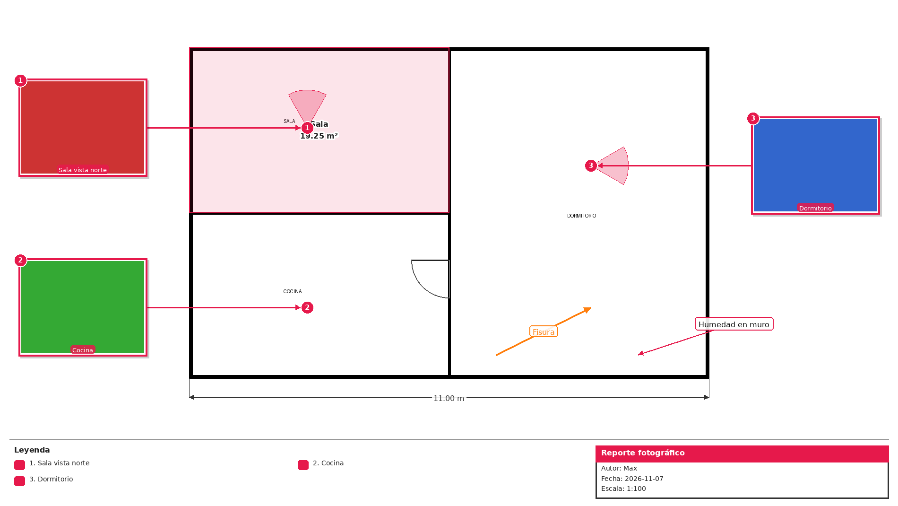

# PixAgent: IA avanzada para PixPin

PixAgent es un agente de IA que funciona como el modo avanzado de [PixPin](https://pixpin.com).
PixPin se encarga de lo básico (capturas, pines, OCR, traducción). Lo que necesita varios pasos lo
envías aquí, y el resultado vuelve a PixPin fijado en pantalla.



## Qué hace

| Especialidad | Ejemplo de petición |
|---|---|
| **Planos con fotos** | "Te paso el plano y 12 fotos: ubica cada una donde se tomó, con flechas, números y cono de visión; leyenda y cajetín." |
| **Editar o crear planos** | "Marca las fisuras en rojo, añade cotas (1 m = 80 px) y calcula el área de cada habitación." |
| **Diagramas** | "Diagrama de flujo del proceso de aprobación de obra" (genera PNG, SVG y PDF) |
| **Informes PDF** | "Informe de inspección con portada, índice, tabla de hallazgos y el plano anotado." |
| **Mini apps** | "Una mini app para calcular metrados" (HTML o Python, lista para abrir con un atajo de PixPin) |
| **Python** | Cualquier librería: Pillow, pandas, matplotlib, reportlab, pymupdf, openpyxl... |

### Cómo trabaja (comportamiento agéntico)

1. **Planifica**: para tareas largas crea una lista de pasos visible en la interfaz.
2. **Mira**: lee el plano con una **cuadrícula de coordenadas** y revisa cada foto para deducir dónde se tomó.
3. **Actúa** con herramientas especializadas: `compose_plan`, `render_diagram`, `create_pdf`, `create_miniapp`, `run_python`...
4. **Verifica**: cada herramienta le devuelve una **imagen del resultado** (el plano renderizado, la captura de la mini app, las páginas del PDF) y corrige hasta que quede bien.
5. **Entrega**: guarda los archivos ordenados y, si lo pides, los fija en PixPin.

## Mini apps (sin gastar tokens)

Son herramientas pequeñas que hacen el trabajo **en el navegador**, al instante y sin coste de IA.
Llaman a la IA solo si se lo pides (por ejemplo, para redactar pies de foto), y para eso usan un
modelo económico. Se abren desde la pestaña **Mini apps**, sueltas en `/apps/<nombre>/` o con un
atajo de PixPin.

| Mini app | Qué hace |
|---|---|
| **Escaleras y graderías** | A partir de la altura y la distancia calcula contrahuellas, huellas, tramos y descansos (con la regla de Blondel), o gradas con su escalera de acceso. Dibuja corte con cotas, planta, isométrico y un modelo 3D que se puede girar. Da volumen de concreto y encofrado, imprime a PDF y fija en PixPin |
| **Panel fotográfico** | Sueltas tus fotos, eliges la disposición y obtienes el PDF del panel con cabecera, numeración y pies de foto. Los pies con IA son opcionales: una sola llamada barata para todas las fotos |
| **Calculadora** | Científica con historial, conversor de unidades y cálculos de obra (losas, zapatas, concreto por resistencia, ladrillos por m², pendientes) |
| **Detector de gestos** | Cámara + reconocimiento de gestos de la mano en el propio dispositivo |

El agente puede crear mini apps nuevas a petición ("hazme una mini app para…"). Todas usan el
[SDK de PixAgent](docs/MINIAPPS_SDK.md): guardar, subir, fijar en PixPin, IA rápida y panel
fotográfico.

## IA local (modelos pequeños, gratis y privados)

PixAgent se conecta a **Ollama, llama.cpp, LM Studio** o cualquier servidor compatible con OpenAI y
usa modelos pequeños (Qwen3.5, Qwen3-VL, Gemma 4, MiniCPM-V, GLM-OCR…) como herramientas para
trabajo masivo: describir fotos, OCR, narrar vídeos fotograma a fotograma (desde un archivo, una URL
o en directo con la cámara o la pantalla) y transcribir audio. Claude delega en ellos con la
herramienta `local_ai` y las mini apps los usan con `PixAgent.local`. Incluye las mini apps
**IA local** (instalar y elegir modelos), **Analizador de vídeo** y **OCR rápido**. Guía completa,
modelos recomendados por equipo y resultados de las pruebas: [docs/IA_LOCAL.md](docs/IA_LOCAL.md).

## Creador de informes estructurados

En `/reports` (pestaña **Informes**) defines **tus propias plantillas**: campos del proyecto,
secciones con instrucciones y extensión, secciones por zona con sus fotos, tabla de datos, panel
fotográfico, firma... Luego creas informes a partir de ellas. Incluye tres plantillas: inspección
técnica, avance de obra e informe extenso con estructura automática.

**Cómo hace informes de 100 páginas**: ningún modelo escribe 100 páginas de una vez. Se usa el
patrón de los agentes de escritura larga (Claude Code con subagentes, LongWriter, STORM):

1. Se crea un **índice** con un objetivo de palabras por apartado. Puede ser la plantilla o uno que
   la IA propone y tú editas.
2. **Cada apartado se redacta en una llamada separada**, varias en paralelo. Cada llamada recibe
   solo lo que necesita: datos, notas, instrucciones, *sus* fotos y resúmenes de las secciones de
   las que depende. Así la calidad se mantiene y el coste crece de forma lineal, no explosiva.
3. **Cada parte se guarda en disco** al terminar. Puedes editarla a mano, regenerar solo una o
   reanudar si se corta.
4. Se **ensambla** el PDF (portada, índice, tablas, fotos, panel). Las partes sin IA (tabla de
   datos, panel fotográfico, firma) no gastan tokens.

Antes de generar se muestra una **estimación de llamadas, tokens y coste**. En las pruebas
(con un redactor simulado), un informe de 40 apartados se ensambla en un PDF de ~100 páginas en
segundos. El tiempo real depende del modelo, porque las partes se redactan en paralelo.

El agente del chat también puede usarlo: "créame un informe de inspección con estas fotos usando
mi plantilla".

## Integración con PixPin

La integración usa la [API de scripts oficial de PixPin](https://pixpin.com/docs/configuration/script)
(`PixPin.exe -f script.js`) en las dos direcciones:

- **PixPin → agente**: atajos de PixPin que envían la última captura, la ventana activa o el
  portapapeles a la bandeja `inbox/`. La interfaz los recibe al instante como adjuntos.
- **Agente → PixPin**: el agente fija en pantalla planos, diagramas, páginas de PDF o capturas de
  mini apps (`pixpin.pinFromFiles`). También puede pedir capturas a PixPin.
- **Mini apps**: cada mini app trae `abrir_en_pixpin.js` para abrirla con un atajo de PixPin.

Detalles en [pixpin_scripts/README.md](pixpin_scripts/README.md).

## Plataformas

PixAgent usa una arquitectura de **anfitrión + clientes ligeros**:

- **Anfitrión**: un único proceso de Python hace el trabajo pesado (planos, PDFs, Python). Puede
  ser tu PC con Windows, tu Mac, un servidor casero o en la nube (Docker) o un teléfono Android con
  Termux.
- **Clientes**: los demás dispositivos usan una **app web instalable (PWA)** de unos 70 KB, sin
  frameworks. No hace falta instalar nada desde la tienda y no consume la batería ni la memoria de
  una app nativa. El modelo de IA corre en la nube, así que el teléfono solo muestra resultados.

| Plataforma | Cómo se usa | PixPin |
|---|---|---|
| **Windows** | Anfitrión: `instalar.bat` + `iniciar.bat`. Se abre como ventana de app (Edge en modo app, sin Electron) | ✅ Integración completa |
| **macOS** | Anfitrión: `./iniciar.sh` | ✅ Integración completa (PixPin para Mac) |
| **iPhone / iPad** | Cliente: abre la URL o escanea el QR del anfitrión y elige Safari → Compartir → *Añadir a pantalla de inicio* | Desde el móvil: fijar resultados y pedir capturas en el PC anfitrión |
| **Android** | Cliente: abre la URL o el QR → *Instalar app*. Aparece en el menú *Compartir* de la galería para enviar fotos directamente | Igual que iOS |
| **Android sin PC** | Anfitrión en el propio teléfono con [Termux](https://termux.dev): `./iniciar_termux.sh` | No (PixPin no existe en Android) |
| **Linux / NAS / VPS** | Anfitrión con `docker build -t pixagent . && docker run -p 8765:8765 -e ANTHROPIC_API_KEY=… -v pixagent:/data pixagent` | No |

### Usarlo desde el móvil o la tablet

```bash
python -m pixagent serve --lan      # misma wifi: muestra una URL con token y un código QR
```

Escanea el QR: el móvil queda emparejado (una cookie guarda el token) y puedes instalar la app.
Para **instalar la PWA** en Android/iOS fuera de casa se necesita HTTPS. Lo más sencillo es
[Tailscale](https://tailscale.com): `tailscale serve 8765` en el anfitrión, y arrancas PixAgent con
`--remote` para que siga exigiendo el token. Si ya tienes certificados, usa `--cert` y `--key`.

### Optimización para dispositivos modestos

- **Fotos reducidas en el propio dispositivo** antes de subirlas (máx. 3200 px; HEIC del iPhone →
  JPEG). Una foto de 48 MP se sube como una fracción de su tamaño, y la memoria del canvas se libera al terminar.
- **Miniaturas WebP en caché** del tamaño exacto de la pantalla. El original solo se descarga al
  ampliar. Hay un modo **Ahorro de datos** (y se respeta el *Ahorro de datos* del sistema).
- **PDF en iOS/iPadOS** mostrado como páginas en imagen de carga diferida (Safari solo muestra la
  primera página en un iframe).
- **Conexión que se recupera sola**: eventos numerados con búfer en el anfitrión. Si iOS o Android
  suspenden la app o cambias de wifi a datos, al volver se recupera lo que faltaba.
- **Menos trabajo en el móvil**: el texto del modelo llega agrupado cada 60 ms y se repinta como
  máximo una vez por fotograma. Los historiales largos se recortan en el DOM, se usa
  `content-visibility` y las tarjetas de herramientas cargan su contenido al abrirse.
- **Red**: gzip solo para texto (no para imágenes), recursos estáticos inmutables en caché y
  service worker para que la app abra al instante. Primera carga: unos 70 KB.
- **Anfitrión ligero**: ~54 MB en reposo. El SDK de IA, el motor de PDF y matplotlib se cargan solo
  cuando se usan, máximo 8 sesiones en memoria, y las dependencias pesadas son opcionales
  (`.[full]`). Sin ellas, las funciones que las necesitan avisan en lugar de fallar.
- **Interfaz adaptable**: tres columnas en escritorio, columna única con barra inferior en móvil,
  zonas táctiles de 42 px o más, márgenes seguros del notch, sin zoom involuntario en iOS, modo
  oscuro automático y cámara directa desde el compositor.

## Instalación

Requisitos: Python 3.10+ y una clave de API de Anthropic.

**Windows**

```bat
instalar.bat
setx ANTHROPIC_API_KEY "tu_clave"
iniciar.bat            (o: iniciar.bat --lan  para usarlo también desde el móvil)
```

**macOS / Linux**

```bash
export ANTHROPIC_API_KEY="tu_clave"
./iniciar.sh
```

**Android (Termux)**

```bash
export ANTHROPIC_API_KEY="tu_clave"
./iniciar_termux.sh
```

Después, en el PC con PixPin:

```bash
python -m pixagent install-pixpin      # genera los scripts para PixPin con tus rutas
python -m pixagent config pixpin_path="C:/Program Files/PixPin/PixPin.exe"   # si no se autodetecta
```

## Uso

| Comando | Para qué |
|---|---|
| `python -m pixagent` | Interfaz web (chat, visor de planos/PDF/apps, biblioteca, botones de PixPin) |
| `python -m pixagent serve --lan` | Además, accesible desde móviles y tablets de tu red (QR + token) |
| `python -m pixagent chat` | Chat en la terminal (`/adjuntar ruta…` para adjuntar) |
| `python -m pixagent run "tarea" -a plano.png foto1.jpg` | Ejecuta una tarea y termina |
| `python -m pixagent send archivo.png` | Envía archivos a la bandeja del agente |
| `python -m pixagent send-clipboard` | Envía la imagen o el texto del portapapeles |
| `python -m pixagent config clave=valor` | Cambia la configuración (`~/.pixagent/config.json`) |

En la interfaz puedes arrastrar archivos, pegar capturas con Ctrl+V, hacer fotos con la cámara
(móvil y tablet), compartir resultados con la hoja nativa del sistema y usar los botones de plantilla
(Plano con fotos, Diagrama, Informe PDF, Mini app, Python).

### Configuración principal

| Clave | Por defecto | Notas |
|---|---|---|
| `workspace` | `~/PixAgent` | Carpeta de trabajo: `uploads/ inbox/ plans/ diagrams/ reports/ apps/ outputs/` |
| `model` | `claude-opus-5-5` | Modelo de Claude (agente e informes) |
| `quick_model` | `claude-haiku-5-5` | Modelo económico para la IA de las mini apps |
| `effort` | `high` | `low`, `medium`, `high`, `xhigh` o `max` |
| `permission_mode` | `auto` | `auto`: pide permiso solo para la shell. `ask`: también para Python y PixPin. `full`: sin preguntas ni límites de carpeta |
| `enable_web` | `true` | Búsqueda y lectura web del lado del servidor |
| `server_fallbacks` | `true` | Si el modelo rechaza una petición, se reintenta en el modelo de respaldo |
| `progress_updates` | `true` | Muestra notas de progreso entre herramientas |
| `allowed_dirs` | `[]` | Carpetas extra a las que puede acceder (separadas por `;`) |
| `require_token` / `access_token` | `false` / auto | Se activan solos con `--lan` y `--remote` |
| `upload_max_px` | `3200` | Lado máximo de las fotos que se suben desde los dispositivos |

## Arquitectura

```
pixagent/
  agent.py          bucle agéntico (historial solo-añadir, resultados en paralelo, permisos, sesiones)
  llm.py            Claude: streaming, pensamiento adaptativo, esfuerzo, caché de prompts, fallbacks
  prompts.py        prompt de sistema especializado
  pixpin_bridge.py  puente con PixPin (scripts JS, pinFromFiles, capturas, lanzadores)
  tools/
    files.py        read_file, write_file, edit_file, list_files, search_files
    execution.py    run_python, run_shell, todo_write
    vision.py       view_image (cuadrícula de coordenadas y zoom), image_tools (hoja de contactos...)
    plan.py         compose_plan: motor de planos declarativo (escena JSON reeditable)
    diagram.py      render_diagram: disposición automática por capas, PNG + SVG + PDF, Mermaid
    documents.py    create_pdf (Markdown → PDF profesional), pdf_tools
    browser.py      preview_page (captura de HTML), html_to_pdf (Playwright, o Edge/Chrome)
    pixpin_tools.py pixpin (pin/capture/run_script), create_miniapp
    panel.py        photo_panel: panel fotográfico PDF determinista
    reports_tool.py report_builder: informes por plantilla (para el agente)
  reports/
    engine.py       motor de informes: plantillas, unidades, redacción en paralelo, estado, ensamblado
    templates/      plantillas integradas (JSON)
  miniapps/         mini apps integradas (graderio, panel-fotografico, calculadora, detector-gestos)
  quick_ai.py       IA rápida y económica para las mini apps
  local/            IA local: motores (Ollama/llama.cpp/LM Studio/OpenAI), catálogo, tareas y vídeo
  web/
    server.py       FastAPI + WebSocket: eventos reanudables, token, gzip selectivo, compartir (Android)
    thumbs.py       miniaturas WebP en caché y páginas de PDF como imagen
    static/         PWA sin dependencias: index.html, app.js, style.css, manifest, service worker
```

Más detalle sobre las decisiones de diseño en [docs/ARQUITECTURA.md](docs/ARQUITECTURA.md) y sobre lo
aprendido del código de Codex CLI, Gemini CLI, opencode, OpenHands, Cline, Goose y DeepSeek-TUI en
[docs/MEJORAS_HARNESS.md](docs/MEJORAS_HARNESS.md) (compactación, subagentes, habilidades, recetas
`/comando`, modo plan, rebobinar, detector de atascos…).

## Tests

```bash
pip install -e ".[dev]"
pytest
```

Los tests no usan red: ejecutan las herramientas reales y simulan el modelo para probar el bucle
del agente y el servidor web.
